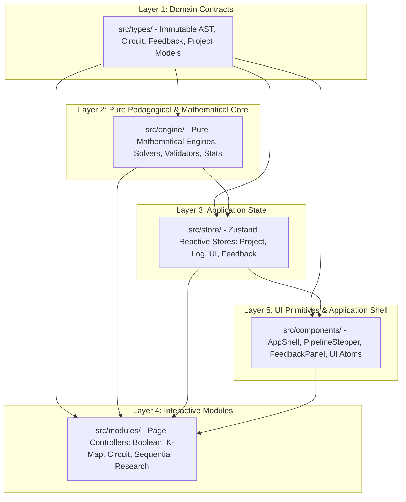

# Digital Electronics Virtual Lab: Design, Exploration, Analysis, and Modeling (DEAM)

The Digital Electronics Virtual Lab (DEAM) is an open-source, browser-based pedagogical workbench and educational research platform for undergraduate computer science and electrical engineering curricula. It addresses foundational learning hurdles in digital logic by providing an integrated synthesis environment where combinational specifications (Boolean expressions, truth tables, and Karnaugh maps) and synchronous sequential systems (flip-flop state machines, counters, and sequence detectors) cascade into interactive gate-level circuit netlists without tool fragmentation. Operating entirely on client-side Web technologies, DEAM pairs mathematically rigorous, oracle-verified grading engines with a continuous diagnostic feedback framework that classifies student errors against an empirical 21-tag misconception catalog, delivers 3-tier progressive hints, and detects answer traps.

## Research Gaps Addressed

- **Tool Fragmentation (Gap 1)**: Unifies historically isolated educational tools (truth table generators, K-map solvers, gate simulators, and state machine synthesizers) into a single, persistent `DesignProject` pipeline that eliminates cognitive context switching.
- **Step-Level Cognitive Feedback (Gap 2)**: Replaces monolithic end-of-task grading with continuous, deterministic step-level diagnostics mapped to a 21-tag misconception catalog and a 3-tier progressive hint ladder.
- **Deterministic Core vs. Bounded LLMs (Gap 3)**: Preserves mathematical rigor through oracle-verified core algorithms while confining generative AI to an optional, strictly display-only pedagogical rephrasing layer that cannot override grading verdicts.

---

## Active Modules

Every active module is fully implemented in the current Phase 1 delivery:

- **Number Systems Workbench**: Radix base conversions (Binary, Octal, Decimal, Hexadecimal, BCD, Sign-Magnitude, 1's and 2's Complement) with step-by-step arithmetic diagnostics.
- **Boolean Algebra Engine**: Canonical expression parser, AST generator, truth table evaluator ($N \le 6$), and heuristic algebraic simplifier with step-by-step axiomatic law verification.
- **Karnaugh Map (K-Map) Solver**: Interactive 2-to-5 variable spatial minimization grid featuring Quine-McCluskey/Petrick solver, student group validator, and prime implicant classification.
- **Logic Circuit Simulator**: Interactive SVG-based schematic capture and discrete-event priority queue simulation (AND, OR, NOT, NAND, NOR, XOR, XNOR) tested up to 500 gates.
- **Flip-Flop Laboratory**: Characteristic table, excitation table, and clock timing diagram simulator for SR, D, JK, and T flip-flops with edge-triggering and master-slave latching.
- **Sequential Circuit Designer**: Synchronous counter synthesis (up/down/arbitrary mod) and sequence detector synthesis (Mealy/Moore, overlapping/non-overlapping) with unused state lockout diagnosis.
- **Practice Arena**: Procedurally seeded multi-topic problem generator with step-by-step submission, tiered hints, and reference solution walkthroughs.
- **Diagnostic Quiz Arena**: Formative multiple-choice assessments with tagged misconception distractors and active cognitive error classification.
- **Pre/Post Evaluation Suite**: Counterbalanced parallel instruments (Forms A and B) measuring normalized learning gain ($g$) across controlled study cohorts.
- **System Usability Scale (SUS)**: Integrated 10-item standard usability questionnaire with automated Brooke scoring (0-100) and percentile mapping.
- **Teacher Research Dashboard**: On-device aggregation of multi-session telemetry CSV exports with descriptive statistics, paired $t$-tests, Cohen's $d$, and misconception frequency charts.

*Note on Phase 2 Modules*: Arithmetic Logic Unit (ALU), 8086 Microprocessor Emulator, and 8259A Interrupt Controller are reserved architectural slots not built in this Phase 1 delivery; they are scheduled for future development.

---

## Quick Start

### Prerequisites
- **Node.js**: `v20.0.0` or higher (tested and verified on Node `v22.23.1`)
- **npm**: `v10.0.0` or higher
- **Modern Web Browser**: Chrome 131+, Edge 131+, or Firefox 133+

### Installation & Local Development
```bash
# Clone the repository
git clone https://github.com/[INSTITUTION-OR-USER]/DEAM_CP.git
cd DEAM_CP

# Install dependencies (strictly locked via package.json)
npm install

# Start the Vite local development server
npm run dev

# Build production bundle with full TypeScript typechecking
npm run build

# Preview the production build locally
npm run preview
```

### Verification & Testing
```bash
# Execute unit and integration tests (151 files, 1,020 tests)
npm run test

# Run ESLint across TypeScript and TSX sources (zero warnings allowed)
npm run lint

# Execute TypeScript type checker
npm run typecheck

# Install Playwright browser binaries (one-time setup)
npx playwright install chromium

# Run full end-to-end test suite (Desktop and Mobile Chromium)
npm run e2e

# Generate and verify documentation artifacts
npm run docs:catalog
npm run docs:report
npm run docs:check
```

---

## System Architecture

The application is structured into five strictly layered tiers with unidirectional dependencies:



For complete architectural details, see [docs/architecture.md](file:///d:/Projects/DEAM_CP/docs/architecture.md).

---

## Repository Directory Map

- `docs/`: Comprehensive technical architecture, user guide, misconception catalog, test report, evaluation protocol, and research gap mapping.
- `scripts/`: Vite-node automation scripts for generating the misconception catalog and extracting machine-readable test statistics.
- `src/components/`: Reusable presentation primitives, application layout shell, pipeline stepper, and feedback modal/card components.
- `src/engine/`: Pure, zero-dependency mathematical algorithms, minimization solvers, discrete simulators, diagnostic validators, and statistical calculators.
- `src/hooks/`: Custom React hooks for keyboard shortcut navigation and responsive viewport detection.
- `src/modules/`: Interactive workbench modules (Boolean, K-Map, Circuit, Flip-Flop, Sequential, Practice, Quiz, Research).
- `src/store/`: Zustand reactive state stores managing project state, local telemetry logs, UI theme/preferences, and study consent.
- `src/types/`: Centralized TypeScript interfaces, AST definitions, feedback contracts, and project serialization models.
- `src/utils/`: Common utilities including deterministic pseudo-random number generators and formatting helpers.
- `tests/`: End-to-end integration and user journey specs executed via Playwright.

---

## Adding a New Module

To integrate an additional pedagogical module into the workbench, execute the following numbered checklist:

1. **Register the Module**: Add an entry to `MODULE_REGISTRY` in `src/modules/registry.ts` defining its unique `id`, label, route, category, and pipeline stage.
2. **Define State Contracts**: If the module participates in cross-module handoffs, declare its reads and writes in `DesignProject` (`src/types/project.ts`).
3. **Implement Pure Mathematical Engine**: Place all algorithms, solvers, and parsers in `src/engine/<module-name>/`. Maintain zero React and zero DOM dependencies.
4. **Register Step Validators & Misconceptions**: Define step validators in `src/engine/feedback/validatorRegistry.ts` and tag any domain-specific cognitive errors in `src/engine/feedback/misconceptions.ts`.
5. **Add Problem Generators**: Implement procedural problem generation in `src/engine/practice/problemGenerators.ts`.
6. **Provide Seed Reference Projects**: Add reference seed configurations in `src/engine/practice/seedProjects.ts`.
7. **Build UI View Controller**: Create `src/modules/<module-name>/<ModuleName>Page.tsx` using design system primitives from `src/components/`, and mount the route in `src/App.tsx`.
8. **Document Module in User Guide**: Add a complete section in `docs/user-guide.md` covering purpose, inputs, outputs, UI controls, shortcuts, and common mistakes.
9. **Add Test Coverage**: Implement unit tests in `src/engine/<module-name>/` and walkthrough integration tests in `src/modules/<module-name>/`.

---

## Human Subject Evaluation Protocol

Researchers planning classroom deployments or empirical pedagogical studies should consult the comprehensive protocol in [docs/evaluation-protocol.md](file:///d:/Projects/DEAM_CP/docs/evaluation-protocol.md). It details:
- Study designs (single-group pre/post and two-group comparison) with statistical power guidelines.
- IRB-ready informed consent text in plain language with explicit data minimization disclosures.
- 12-column telemetry CSV dictionary and active step timing calculation rules.
- Reproducible Python/pandas and R analysis scripts for computing normalized Hake gain ($g$), Cohen's $d$, paired $t$-tests, and Brooke SUS metrics.

### Privacy and Data Handling Summary
- **100% Client-Side Execution**: All telemetry events, project files, and quiz submissions reside strictly in browser `localStorage`.
- **Zero Cloud Transmission**: No student names, email addresses, free-text responses, or activity logs are transmitted to any remote server.
- **Complete Local Control**: Researchers merge exported CSV files locally via the Teacher Dashboard, and participants can purge all local study records instantly with a single button click.

### Optional Generative AI Rephrasing
The optional AI rephrasing feature is **disabled by default**. When enabled, students or instructors must provide their own Google Gemini or OpenAI API key. The key is stored solely in client memory/localStorage and is never written to telemetry logs. The external call transmits only the deterministic diagnosis text for empathetic stylistic rephrasing; it cannot alter grading verdicts or hint progression. Institutional studies must ensure their ethics approval explicitly covers third-party LLM processing if enabled.

---

## Browser Support

The application has been verified across the following environments:
- **Google Chrome / Chromium**: Version 131+ (Desktop, Windows 11 `win32 x64`)
- **Google Chrome Mobile**: Emulated Google Pixel 5 via Playwright (32/32 tests green)
- **Microsoft Edge**: Version 131+ (Blink engine)
- **Mozilla Firefox**: Version 133+ (ES2022 JavaScript, SVG Canvas)

---

## Documentation Index

- [docs/architecture.md](file:///d:/Projects/DEAM_CP/docs/architecture.md): Architectural decisions, layer diagrams, data flow pipelines, and formal limits.
- [docs/user-guide.md](file:///d:/Projects/DEAM_CP/docs/user-guide.md): Comprehensive module walkthroughs, exact UI button labels, keyboard shortcuts, and handoff contracts.
- [docs/misconception-catalog.md](file:///d:/Projects/DEAM_CP/docs/misconception-catalog.md): Authoritative 21-tag cognitive error catalog with underlying mental models and 3-tier hints.
- [docs/test-report.md](file:///d:/Projects/DEAM_CP/docs/test-report.md): Empirical test metrics, mathematical oracle verification results, and simulation benchmarks.
- [docs/evaluation-protocol.md](file:///d:/Projects/DEAM_CP/docs/evaluation-protocol.md): Human subject study protocol, consent templates, telemetry dictionaries, and analysis scripts.
- [docs/research-gap-mapping.md](file:///d:/Projects/DEAM_CP/docs/research-gap-mapping.md): Matrix mapping all features to research gaps, evidence limits, and Phase 2 roadmap.

---

## License

[LICENSE TYPE - e.g., MIT License or Educational Community License - to be specified by the researcher]

---

## Citation

```bibtex
@article{DEAM2026,
  author    = {[AUTHOR NAMES - to be completed by the researcher]},
  title     = {DEAM: An Integrated Pedagogical Workbench and Cognitive Diagnostic System for Undergraduate Digital Logic Design},
  journal   = {[JOURNAL OR CONFERENCE NAME - to be completed by the researcher]},
  year      = {2026},
  publisher = {[PUBLISHER NAME - to be completed by the researcher]}
}
```