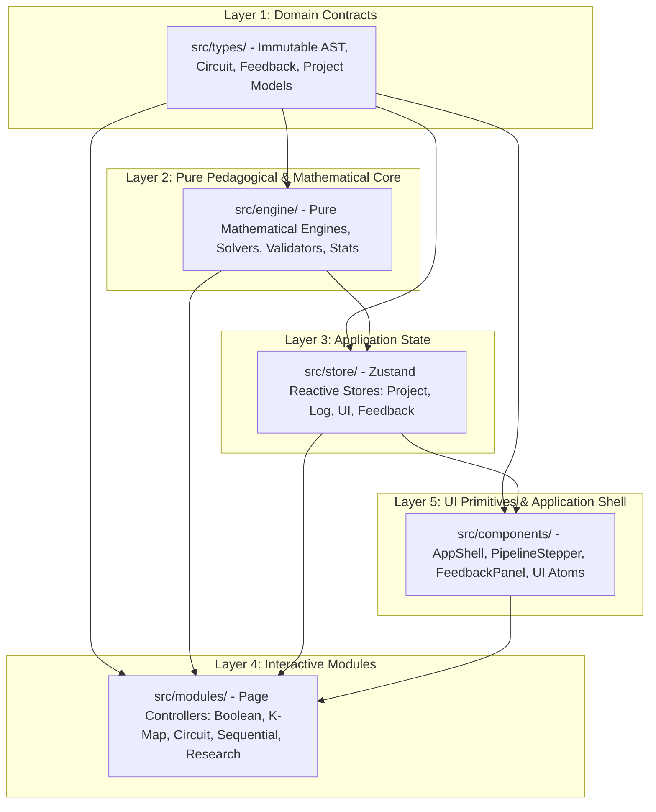
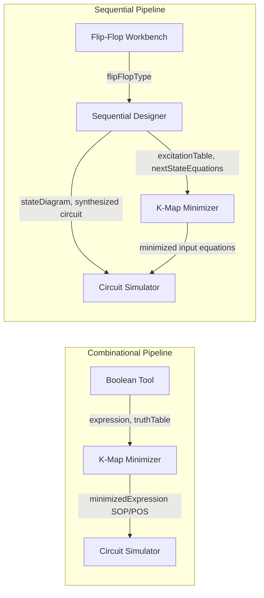
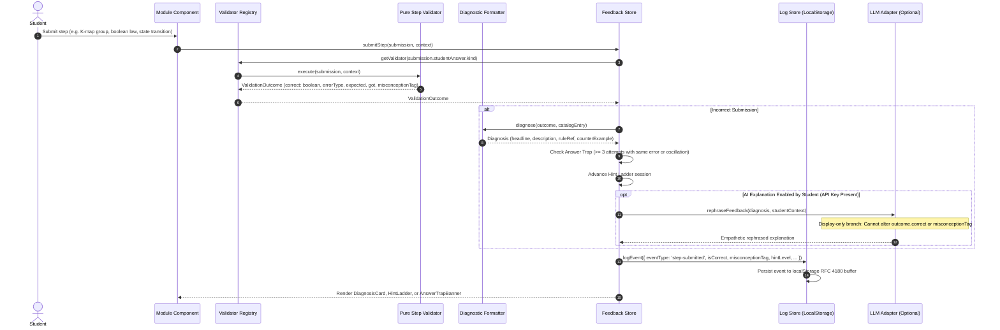

# System Architecture

## 1. Research Context and System Goals

Digital logic design is a foundational subject in computer science and electrical engineering curricula, yet students routinely struggle with conceptual transitions between algebraic formulations, spatial minimization, gate-level schematics, and sequential state machines. Contemporary educational software remains fragmented: students use disparate, single-purpose tools for truth tables, Karnaugh maps, schematic capture, and finite state machines. This separation induces cognitive context switching and prevents learners from experiencing end-to-end design synthesis where a single behavioral specification cascades systematically into a physical gate netlist.

The Digital Electronics Virtual Lab is an integrated, browser-based pedagogical workbench engineered to address three primary research gaps:
1. **Tool Fragmentation (Gap 1)**: Unifying combinational synthesis (Boolean algebra $\rightarrow$ K-map $\rightarrow$ gate circuit) and synchronous sequential synthesis (flip-flop analysis $\rightarrow$ state diagram/table $\rightarrow$ excitation derivation $\rightarrow$ K-map $\rightarrow$ counter/detector netlist) through a singular, persistent `DesignProject` document model.
2. **Step-Level Cognitive Feedback (Gap 2)**: Replacing coarse end-of-task binary verification with continuous, deterministic step-level diagnostics that classify errors against a 21-tag misconception catalog, scaffold recovery through 3-tier progressive hints (Nudge, Pointed, Worked Step), and suppress cognitive thrashing via answer-trap detection.
3. **Deterministic Core vs. Bounded Generative AI (Gap 3)**: Providing mathematically rigorous, oracle-verified automated grading while confining Large Language Models (LLMs) to an optional, strictly display-only role for empathetic pedagogical phrasing that cannot override or corrupt deterministic verification verdicts.

*Note on Phase 2 Modules*: Phase 2 modules (ALU, 8086 CPU, and 8259A Interrupt Controller) are not built in this delivery: they are reserved architectural slots listed as future work.

---

## 2. Layered Architecture

The system is constructed with a strict unidirectional dependency graph spanning five distinct tiers. Lower layers remain pure and completely oblivious to upper layers.

### Import Direction Rules
1. `src/types/`: Contains only TypeScript type definitions, interfaces, and immutable constants. Zero runtime code (with the single exception of `createEmptyDesignProject` factory). Imports nothing from other layers.
2. `src/engine/`: Pure mathematical algorithms, parsers, minimization solvers, discrete-event simulators, and diagnostic validators. Zero React dependencies, zero DOM access, zero Zustand store imports.
3. `src/store/`: Zustand state management for reactive project editing (`projectStore`), persistent telemetry collection (`logStore`), UI preferences (`uiStore`), study consent (`studyStore`), and multi-step validation sessions (`feedbackStore`).
4. `src/modules/`: Domain workbench interfaces (`boolean`, `kmap`, `circuit`, `flipflop`, `sequential`, `practice`, `quiz`, `research`). Connects state stores to domain algorithms.
5. `src/components/`: Reusable presentation primitives (`Button`, `Modal`, `Tabs`, `Table`), application framing (`AppShell`, `PipelineStepper`), and global feedback cards (`DiagnosisCard`, `HintLadder`, `AnswerTrapBanner`).

---

## 3. Data Flow Through Design Pipelines

The central `DesignProject` object flows through two primary synthesis workflows via the `PipelineStepper` and module handoff contracts.

### Handoff Readiness Verification
Inter-module data handoffs are protected by the deterministic `checkHandoffReadiness(project, fromId, toId)` function in `src/modules/registry.ts`:
- **Boolean Tool to K-Map**: Validates that an expression has been parsed or a truth table generated with 2 to 5 variables ($2 \le n \le 5$).
- **K-Map to Circuit Simulator**: Verifies that grouping has produced a minimal SOP or POS equation.
- **Flip-Flop to Sequential Designer**: Enforces selection of a valid bistable multivibrator type (SR, JK, D, or T).
- **Sequential Designer to K-Map**: Ensures the flip-flop excitation table has been derived from present-to-next state transitions.
- **Sequential Designer to Circuit**: Confirms that next-state and output logic equations are synthesized.

---

## 4. Feedback Engine and Telemetry Architecture

Every student interaction that evaluates a step executes through a deterministic pipeline that isolates verification logic from display scaffolding.

---

## 5. The DesignProject Data Model

The `DesignProject` interface (`src/types/designProject.ts`) represents the unified schema for digital design projects:

| Field Name | Type | Written By | Read By | Pedagogical Purpose |
| :--- | :--- | :--- | :--- | :--- |
| `id` | `string` (UUID) | System factory / Import | All stores | Immutable project identity |
| `schemaVersion` | `number` | System factory / Migrations | `projectStore` | Storage format versioning (v2) |
| `name` | `string` | AppShell inline rename | AppShell, Dashboard | User-facing project title |
| `createdAt` | `string` (ISO 8601) | System factory | IO helpers, Dashboard | Project creation timestamp |
| `updatedAt` | `string` (ISO 8601) | `projectStore` (any patch) | IO helpers, Dashboard | Last modification timestamp |
| `variables` | `readonly string[]` | Boolean Tool, K-Map | Boolean, K-Map, Circuit | Ordered input variable labels ($A, B, \dots$) |
| `expression` | `BoolNode \| null` | Boolean Tool | Boolean, K-Map | Parsed Boolean AST |
| `truthTable` | `TruthTable \| null` | Boolean Tool, K-Map | Boolean, K-Map, Circuit | Canonical $2^n$-row truth table |
| `minimizedExpression`| `MinimizedDualForm \| null`| K-Map Solver | Circuit Simulator | Minimal SOP and POS expressions |
| `kmap` | `KMapState \| null` | K-Map Solver | K-Map, Sequential | Minterms, don't-cares, and groups |
| `circuit` | `CircuitGraph \| null` | Circuit Simulator | Circuit, Sequential | Gate-level netlist (nodes and wires) |
| `sequentialSpec` | `SequentialSpec \| null` | Sequential Designer | Sequential Designer | Machine specification (counter/detector) |
| `flipFlopType` | `FlipFlopType \| null` | Flip-Flop Workbench | Sequential Designer | Target bistable memory type (SR/JK/D/T) |
| `stateDiagram` | `StateDiagram \| null` | Sequential Designer | Sequential Designer | FSM states, coordinates, and transitions |
| `stateTable` | `StateTable \| null` | Sequential Designer | Sequential Designer | Present-to-next state tabular mapping |
| `excitationTable` | `ExcitationTable \| null` | Sequential Designer | Sequential, K-Map | Flip-flop input transition requirements |
| `nextStateEquations`| `NextStateEquations \| null`| Sequential Designer | Sequential, Circuit | Synthesized flip-flop input Boolean equations |
| `simulationTrace` | `SimulationTrace \| null` | Circuit, Flip-Flop, Seq | Timing diagram viewers | Discrete-event clock cycle signal history |
| `pipelineProgress` | `PipelineProgress` | Registry handoffs | PipelineStepper | Tracks completed modules in current flow |
| `lastHandoff` | `LastHandoffMetadata \| null`| SendToNextButton | PipelineStepper | Source, target, and payload of last handoff |

---

## 6. Architectural Decision Records (ADRs)

### ADR-01: Bit-Order and Variable Significance Conventions
- **Decision**: Multi-bit integers use big-endian bit significance for text representation (MSB on the left, LSB on the right). Numerical array indexing uses little-endian weights where index $i$ corresponds to weight $2^i$. K-map layout uses standard Gray code reflection ordering ($00, 01, 11, 10$) across both axes.
- **Rationale**: Students commonly confuse positional weights when remainders are read in reverse (`wrong-remainder-order`) or bit indices are flipped (`wrong-bit-order`). Explicitly decoupling visual display (big-endian) from internal mathematical weighting ($2^i$) ensures consistency across conversions and K-map minterm indices ($m = \sum b_i 2^i$).

### ADR-02: Deterministic Core and Oracle-Based Verification
- **Decision**: All educational evaluation is computed via deterministic algorithms running locally in pure TypeScript. For verification, the Quine-McCluskey/Petrick solver is continuously validated against an independent brute-force minimizer across all 3-variable and sampled 4/5-variable Boolean functions.
- **Rationale**: Automated grading in engineering must provide zero false positives. Non-deterministic or heuristic graders undermine student trust. Formal oracle comparison guarantees mathematical soundness.

### ADR-03: Comparing Minimal Covers by Cost Rather than String Identity
- **Decision**: K-map solutions are compared against student groupings by cost ($T_{terms}$ and $L_{literals}$) and validity rather than syntactic identity.
- **Rationale**: Cyclic-core Boolean functions (e.g., $f(A,B,C,D) = \Sigma m(0,2,8,10)$ with don't-cares) possess multiple distinct yet equally minimal prime implicant covers. Rejecting a student's valid minimal cover simply because it differs syntactically from a canonical solver pick is pedagogically harmful and invalidates student exploration.

### ADR-04: SVG Schematic Canvas vs. React Flow
- **Decision**: A custom, lightweight SVG canvas (`src/modules/circuit/Canvas.tsx`) with Manhattan orthogonal routing was implemented instead of adopting heavyweight graph libraries like React Flow.
- **Rationale**: Custom SVG ensures zero external runtime dependencies, precise control over pin hitboxes, sub-millisecond discrete-event gate animation, accessible keyboard element placement, and offline execution without bundle overhead.

### ADR-05: Hash-Based Client Routing Without External Router Library
- **Decision**: Client navigation uses native `window.location.hash` (`#/boolean-tool`, `#/kmap-solver`, etc.) synchronized via a lightweight `hashchange` listener in `uiStore`.
- **Rationale**: Hash routing requires zero router library dependencies and functions reliably on static web hosts, local `file://` execution, and GitHub Pages without requiring server-side URL rewrite fallbacks.

### ADR-06: LocalStorage Persistence and Schema Migration
- **Decision**: All project data is stored under versioned keys (`delab:v1:projects`) with an explicit migration pipeline triggered when `project.schemaVersion < CURRENT_SCHEMA_VERSION` (version 2).
- **Rationale**: Enables seamless offline persistence without requiring database backends. If `localStorage` access is blocked (e.g., private browsing mode), the system displays a non-blocking warning banner and operates smoothly in memory.

### ADR-07: Local-Only Telemetry Logging
- **Decision**: Interaction event logs are buffered exclusively in client-side storage (`delab:v1:event_log`). Telemetry is exported only when the student or researcher explicitly initiates an RFC 4180 CSV or JSON download.
- **Rationale**: Complies with institutional ethics and GDPR/IRB data minimization principles. Avoids transmitting student behavioral telemetry over unverified cloud connections.

### ADR-08: Pluggable Step Validator Registry
- **Decision**: Step validation is implemented as an extensible registry (`src/engine/feedback/validatorRegistry.ts`) indexing pure functions by submission kind.
- **Rationale**: Decouples UI submission components from pedagogical evaluation logic, enabling modules to introduce new problem types without modifying the core feedback pipeline.

### ADR-09: The Large Language Model (LLM) Boundary
- **Decision**: LLMs are restricted strictly to display-only rephrasing of already-computed diagnostic outcomes. The LLM adapter receives only the deterministic diagnosis, the identified misconception tag, and the hint level.
- **Rationale**: Direct LLM evaluation of student logic suffers from hallucinated diagnoses and non-deterministic grading. By enforcing that the LLM adapter cannot modify `ValidationOutcome.correct`, `ValidationOutcome.errorType`, or `ValidationOutcome.misconceptionTag`, pedagogical safety is mathematically guaranteed.

---

## 7. Security and Privacy Architecture

1. **Zero Backend Footprint**: The application compiles to static HTML, CSS, and JavaScript. No application server, database, or analytics tracking script exists.
2. **Data Locality**: All project states, student attempts, and telemetry logs reside in the user's browser `localStorage` and memory.
3. **Telemetry Export Hygiene**: Exported CSV files contain only operational telemetry fields (timestamp, participant ID, module ID, event type, correctness, misconception tag, score). Free-text answers, student names, and browser fingerprints are never recorded.
4. **API Key Security**: If the optional AI explanation feature is enabled, the user's API key is stored exclusively in ephemeral memory or browser session storage. The key is never logged, never included in telemetry CSV exports, and never transmitted to any third party other than direct HTTPS requests to `generativelanguage.googleapis.com`.
5. **Single External Network Call**: When offline, the app performs zero network requests. The only external call permitted in the entire codebase is the optional user-initiated POST request to Google Gemini API for natural-language feedback rephrasing.

---

## 8. Verified Limitations

1. **Algebraic Simplification**: The symbolic simplifier (`src/engine/boolean/simplifier.ts`) uses greedy rule matching (identity, idempotence, complement, absorption, consensus, De Morgan). It does not guarantee a globally minimal expression; Quine-McCluskey in the K-Map module remains the authoritative minimizer.
2. **Variable Limits**:
   - Truth Tables & Boolean Expressions: Capped at 6 variables ($2^6 = 64$ rows) to maintain DOM rendering performance and cognitive readability.
   - Karnaugh Maps: Capped at 5 variables ($2^5 = 32$ cells across two 4x4 sub-maps).
3. **Circuit Netlist Scale**: Tested up to 500 gates (100-bit ripple-carry adder). While discrete-event simulation handles 10,000+ events per second, visual SVG rendering on low-power devices can exhibit frame drops above 1,000 visible nodes.
4. **Browser Testing Coverage**: Fully automated and verified against Chromium 131+ (Desktop Chrome, Microsoft Edge) and Mobile Chromium (Pixel 5 viewport emulation). WebKit and Firefox adhere to the same standard web APIs but are not part of default local CI suites.
