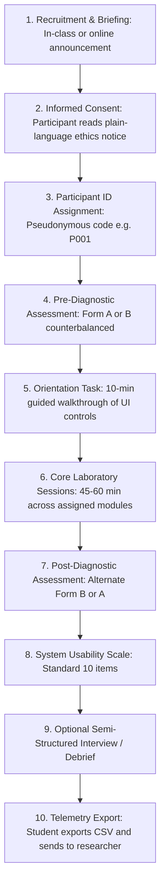

# Empirical Evaluation Protocol

> **Notice to Researchers**: This document serves as a standardized research and evaluation template for empirical deployment of the Digital Electronics Virtual Lab in undergraduate engineering classrooms. It must be adapted to institutional requirements and approved by the local Institutional Review Board (IRB) or Human Research Ethics Committee (HREC). This template does not constitute legal or formal ethical clearance.

## Institutional Fill-In Fields
The following fields must be defined by the primary researcher prior to study commencement:
- `[INSTITUTION NAME - to be completed by the researcher]`
- `[FACULTY / DEPARTMENT NAME - to be completed by the researcher]`
- `[ETHICS APPROVAL REFERENCE NUMBER - to be completed by the researcher]`
- `[PRINCIPAL INVESTIGATOR NAME AND CONTACT - to be completed by the researcher]`
- `[DATA CONTROLLER / PRIVACY OFFICER CONTACT - to be completed by the researcher]`
- `[DATA RETENTION PERIOD - to be completed by the researcher]`
- `[STUDY PHYSICAL LOCATION OR COURSE CODE - to be completed by the researcher]`

---

## 1. Study Purpose and Research Questions

The objective of this protocol is to empirically evaluate whether continuous, step-level cognitive feedback with misconception classification and 3-tiered hint ladders improves learning outcomes and usability compared to conventional binary verification or non-interactive tools in undergraduate digital logic courses.

The data captured by the system directly answers three primary research questions:
- **RQ1 (Error Reduction & Retention)**: *Do deterministic step-level diagnostics and progressive hints reduce the repetition frequency of specific misconceptions across sequential problem-solving attempts?*
  - **Metric**: Within-subject reduction in identical `misconceptionTag` occurrences across successive steps; frequency of answer-trap triggers.
- **RQ2 (Learning Gain Differential)**: *Does the laboratory environment produce statistically significant learning gains on counterbalanced pre/post diagnostic assessments, and how do gains compare across cohort subgroups?*
  - **Metric**: Normalized Hake gain ($\langle g \rangle$), absolute score improvement, paired Student's $t$-test statistic, and Cohen's $d$ effect size.
- **RQ3 (Subjective Usability & Learnability)**: *What is the perceived usability score of the integrated virtual lab among undergraduate engineering students?*
  - **Metric**: Standardized System Usability Scale (SUS) composite score ($0$ to $100$), Bangor/Sauro percentile curve ranking, and learnability sub-scale analysis.

---

## 2. Experimental Designs and Methodological Trade-offs

Researchers may execute either of two standard evaluation designs depending on course logistics and ethical constraints.

### Option A: Single-Group Pre/Post Design (Within-Subject)
- **Structure**: All participants complete: Baseline Pre-Test $\rightarrow$ Orientation Task $\rightarrow$ Experimental Workbench Sessions $\rightarrow$ Post-Test $\rightarrow$ SUS Survey.
- **Advantages**: Requires smaller participant cohorts; eliminates ethical concerns of denying interactive pedagogical scaffolding to an active control group within an accredited course.
- **Limitations & Threats**: Potential historical maturation and testing practice effects (mitigated via parallel Form A / Form B counterbalancing).

### Option B: Two-Group Controlled Comparison (Between-Subject)
- **Structure**: Cohort randomized into:
  - **Experimental Group**: Virtual Lab with full deterministic step-level feedback, progressive hints, and misconception diagnostics.
  - **Comparison Group**: Virtual Lab in baseline mode (binary correct/incorrect feedback only, hint ladders disabled) OR conventional discrete electronic tools / static paper worksheets.
- **Advantages**: Directly isolates the pedagogical contribution of the Feedback Engine (Gap 2) against traditional grading.
- **Limitations & Threats**: Requires larger sample size ($N \ge 64$ for power $1 - \beta = 0.80$ at medium effect size); potential compensatory rivalry or diffusion of treatment between student peers.

### Sample Size and Statistical Power Guidance
Statistical power depends on the anticipated effect size. For a paired comparison (Option A) detecting a medium effect size ($d = 0.50$, $\alpha = 0.05$, two-tailed, power $1 - \beta = 0.80$):
$$N \ge \frac{(Z_{\alpha/2} + Z_{\beta})^2}{d^2} + \frac{Z_{\alpha/2}^2}{2} \approx 34 \text{ participants}$$

For between-group comparison (Option B, two-sample $t$-test, $d = 0.50$, $\alpha = 0.05$, power $0.80$):
$$N \ge 2 \times \left(\frac{Z_{\alpha/2} + Z_{\beta}}{d}\right)^2 \approx 64 \text{ participants per group (128 total)}$$

*Note*: The descriptive statistics in the Teacher Dashboard (paired $t$, Cohen's $d$, Hake gain) provide instant cohort summaries; for cohorts with $N < 20$, formal inferential conclusions should be reported as exploratory descriptive benchmarks.

---

## 3. Participant Flow



### Protocol Steps and Timing
1. **Recruitment & Information (10 min)**: Introduce the study during laboratory or lecture hours. Clarify that participation is completely voluntary and has zero influence on course marks.
2. **Participant ID Assignment (2 min)**: Assign an anonymous participant identifier (e.g. `P001`, `P002`). Prohibit using student matriculation numbers, legal names, or institutional email handles.
3. **Pre-Test Assessment (15 min)**: Navigate to `#/prepost-test`. Enter the participant ID. The system determines whether Form A or Form B is administered based on cryptographic hash parity ($H(\text{ID}) \pmod 2$), guaranteeing automatic 50/50 counterbalancing.
4. **Orientation Task (10 min)**: Students complete a non-graded starter exercise (e.g. entering an expression in Boolean Analysis and toggling one K-map cell) to familiarize themselves with button locations and navigation.
5. **Laboratory Practice Sessions (45–60 min)**: Students work through targeted exercises in:
   - Combinational Pipeline: Boolean Tool $\rightarrow$ K-Map Solver $\rightarrow$ Circuit Simulator.
   - Sequential Pipeline: Flip-Flop Workbench $\rightarrow$ Synchronous Counter Designer.
6. **Post-Test Assessment (15 min)**: Return to `#/prepost-test`. The counterbalancing engine automatically administers the alternate parallel form (Form B if pre-test was Form A, or vice versa).
7. **Usability Survey (5 min)**: Navigate to `#/sus-survey`. Complete the 10 Likert statements.
8. **Optional Qualitative Interviews (10 min)**: Select a representative subset of participants for brief semi-structured interviews.
9. **Data Export & Submission (3 min)**: Students click **Export CSV** in their session dashboard or settings panel, saving `delab-events-<ID>.csv`, and submit the file via the course portal or flash drive.

---

## 4. Participant Information and Consent Form Template

*To be adapted by the researcher onto institutional letterhead.*

```text
PARTICIPANT INFORMATION STATEMENT & INFORMED CONSENT

Study Title: Empirical Evaluation of Cognitive Diagnostic Scaffolding in Digital Logic Learning
Principal Investigator: [PRINCIPAL INVESTIGATOR NAME AND CONTACT - to be completed by the researcher]
Institution: [INSTITUTION NAME - to be completed by the researcher]
Ethics Approval Reference: [ETHICS APPROVAL REFERENCE NUMBER - to be completed by the researcher]

1. Purpose of the Study
You are invited to participate in a research project evaluating how interactive computer-aided design tools and step-level diagnostic hints assist engineering students in learning digital electronics concepts.

2. Voluntary Participation and Right to Withdraw
Your participation in this study is entirely voluntary. You may choose not to participate, or you may withdraw at any time without penalty, loss of course credit, or impact on your academic grades. You can immediately delete all study data stored on your device at any time by clicking the "Delete all my local study data" button in the laboratory settings.

3. What Information Is Collected?
The application records interaction telemetry locally in your browser storage. Specifically, the software records:
- An anonymous participant identifier (e.g., P001).
- Timestamped interaction events (when an exercise step is started, submitted, or a hint is viewed).
- Correctness outcomes (true/false) and identified educational misconception tags (e.g., forgot-wraparound-grouping).
- Diagnostic pre/post multiple-choice selections and System Usability Scale (SUS) survey responses.
- Active time spent per exercise step.

4. What Information Is NEVER Collected?
The software does NOT collect:
- Your name, student ID number, or email address.
- Your computer IP address or hardware MAC address.
- Keystroke contents outside designated exercise inputs.
- Any network telemetry sent to external tracking servers.

5. Data Storage, Export, and Retention
All data is stored exclusively on your local computer in your browser's local storage. No data is transmitted automatically over the internet. At the end of the laboratory session, you will be asked to download your anonymized CSV event log and submit it to the researcher via [LOCATION / FACILITY WHERE STUDY OCCURS - to be completed by the researcher].
Collected research logs will be stored securely on encrypted institutional storage for [DATA RETENTION PERIOD - to be completed by the researcher] and accessible only to approved research personnel.

6. Optional AI Explanation Feature (Ethics Notice)
[MANDATORY NOTICE: If the optional AI explanation feature is enabled in this study, the following paragraph MUST be included. If disabled, keep the feature turned OFF in laboratory settings.]
"The application includes an optional natural-language explanation feature powered by the Anthropic Messages API. If you explicitly enable it and provide an API key, diagnostic feedback is sent over HTTPS to Anthropic for rephrasing. Do not include identifying or confidential information. If your ethics clearance does not cover third-party cloud processing, this feature MUST remain disabled."

7. Contact for Inquiries and Ethics Complaints
If you have questions about the research, please contact [PRINCIPAL INVESTIGATOR NAME AND CONTACT - to be completed by the researcher].
If you have concerns regarding your rights as a research participant, contact the [DATA CONTROLLER / PRIVACY OFFICER CONTACT - to be completed by the researcher].
```

---

## 5. Evaluation Instruments

### Pre-Test and Post-Test Parallel Diagnostic Forms
The diagnostic battery (`src/engine/evaluation/prepostData.ts`) comprises two parallel forms (Form A and Form B), each containing 20 multiple-choice questions rigorously balanced across the undergraduate syllabus:
- **Number Systems & Arithmetic (4 items)**: Positional radix expansion, two's complement overflow, hexadecimal grouping, and BCD addition.
- **Boolean Algebra (3 items)**: De Morgan's duality, algebraic distribution vs. absorption, and consensus theorem.
- **Karnaugh Map Minimization (4 items)**: Toroidal boundary wraparound, non-power-of-two rejection, essential prime implicant deduction, and don't-care optimization.
- **Digital Logic Circuits (3 items)**: Discrete gate propagation, NAND/NOR universal gate equivalence, and half/full adder carries.
- **Flip-Flops & Latches (3 items)**: Characteristic vs. excitation derivation, edge-triggering, and level-triggered race-around conditions.
- **Synchronous Sequential Design (3 items)**: State transition derivation, flip-flop excitation requirements, and unused state lockout deadlock.

#### Distractor Design and Equivalence
Every incorrect distractor in both Form A and Form B was constructed to reflect a specific cognitive flaw in the misconception catalog. Item pairs across Form A and Form B share identical underlying mathematical structures, distractors targeting identical misconception tags, and equivalent cognitive load, differing only in numerical values or literal naming. It is recommended that course instructors review items prior to study execution to ensure alignment with local syllabi.

### System Usability Scale (SUS)
The System Usability Scale (Brooke 1996) is a 10-item instrument measuring subjective system usability:
1. *I think that I would like to use this system frequently.* (Odd, Positive)
2. *I found the system unnecessarily complex.* (Even, Negative)
3. *I thought the system was easy to use.* (Odd, Positive)
4. *I think that I would need the support of a technical person to be able to use this system.* (Even, Negative)
5. *I found the various functions in this system were well integrated.* (Odd, Positive)
6. *I thought there was too much inconsistency in this system.* (Even, Negative)
7. *I would imagine that most people would learn to use this system very quickly.* (Odd, Positive)
8. *I found the system very cumbersome to use.* (Even, Negative)
9. *I felt very confident using the system.* (Odd, Positive)
10. *I needed to learn a lot of things before I could get going with this system.* (Even, Negative)

#### Scoring Formula
For each participant with response vector $R_1, \dots, R_{10} \in \{1, 2, 3, 4, 5\}$:
$$S_{odd} = \sum_{i \in \{1,3,5,7,9\}} (R_i - 1), \quad S_{even} = \sum_{i \in \{2,4,6,8,10\}} (5 - R_i)$$
$$\text{SUS Score} = (S_{odd} + S_{even}) \times 2.5 \quad (0 \le \text{Score} \le 100)$$

#### Interpretation Guide (Sauro & Lewis 2012)
- **Score $\ge 80.3$**: Grade A (Top 10% percentile; excellent usability).
- **Score $68.0 - 80.2$**: Grade B / C+ (Industry benchmark average is 68.0).
- **Score $51.0 - 67.9$**: Grade C / D (Marginal usability; interface friction present).
- **Score $< 51.0$**: Grade F (Unacceptable usability).
*Note*: A SUS score is an ordinal percentile index, not a percentage mark.

---

## 6. Telemetry Data Dictionary and Analysis Plan

### Telemetry CSV Column Dictionary
The telemetry log exported by the application adheres to RFC 4180 CSV specifications and contains 12 explicit columns (`src/types/logging.ts`):

| Column Name | Data Type | Nullable | Description and Sample Value |
| :--- | :--- | :---: | :--- |
| `id` | `string` (UUID) | No | Unique event identifier (`"550e8400-e29b-41d4-a716-446655440000"`). |
| `sessionId` | `string` | No | Random browser session token (`"sess-1718000000"`). |
| `participantId`| `string` | Yes | Pseudonymous researcher ID (`"P042"` or `null`). |
| `moduleId` | `string` | No | Generating module (`"kmap-solver"`, `"boolean-tool"`, etc.). |
| `timestamp` | `string` (ISO 8601)| No | Millisecond timestamp (`"2026-10-14T09:15:30.123Z"`). |
| `eventType` | `string` | No | Event kind (`"step-started"`, `"step-submitted"`, `"hint-requested"`, `"handoff-initiated"`, `"quiz-completed"`, `"pretest-completed"`, `"posttest-completed"`, `"sus-completed"`). |
| `stepId` | `string` | Yes | Exercise step identifier (`"step-kmap-group-1"`, `"q-3"`). |
| `isCorrect` | `boolean` | Yes | Step outcome (`true`, `false`, or `null` for non-evaluation events). |
| `misconceptionTag`| `string` | Yes | Cognitive tag from catalog (`"forgot-wraparound-grouping"`). |
| `hintLevel` | `number` (1, 2, 3)| Yes | Level of hint viewed: `1` (Nudge), `2` (Pointed), `3` (Worked). |
| `score` | `number` | Yes | Score on test or quiz completion (`18.0`). |
| `details` | `string` | Yes | Contextual details (e.g. formula, group coordinates). |

### Active Time per Step Calculation Rules
Active time per step is calculated by computing the interval between `step-started` (or previous step submission) and `step-submitted`.
- **Idle Threshold**: If no mouse, keyboard, or touch event occurs for $> 120$ seconds, idle time is capped to prevent inflated time-on-task metrics when students leave screens unattended.

### Analysis Plan

#### 1. Data Cleaning and Validation
- Verify RFC 4180 integrity. Drop duplicate event IDs if students imported overlapping backups.
- Exclude sessions with total active time $< 10$ minutes or incomplete pre/post pairs.

#### 2. Learning Gain Analysis (Pre/Post)
For each participant with pre-test score $S_{pre}$ and post-test score $S_{post}$ out of maximum score $S_{max} = 20$:
- Absolute Score Gain: $\Delta S = S_{post} - S_{pre}$
- Normalized Hake Gain ($\langle g \rangle$):
  $$g = \frac{S_{post} - S_{pre}}{S_{max} - S_{pre}} \quad (\text{for } S_{pre} < S_{max})$$
  - Low Gain: $g < 0.30$
  - Medium Gain: $0.30 \le g < 0.70$
  - High Gain: $g \ge 0.70$
- Inferential Testing: Run two-tailed paired Student's $t$-test on $(S_{post}, S_{pre})$ and report $t$-statistic, degrees of freedom ($df = N - 1$), $p$-value, and Cohen's $d$:
  $$d = \frac{\bar{S}_{post} - \bar{S}_{pre}}{s_{pooled}}$$

#### 3. Cognitive Misconception Progression
- Tally aggregate frequency of each `misconceptionTag` across early vs. late problem steps.
- Evaluate whether repeated occurrences of the same misconception decline following Level 2/3 hint exposure.

#### 4. Usability Distribution
- Calculate mean SUS score, standard deviation, and 95% confidence interval:
  $$\bar{X}_{SUS} \pm 1.96 \times \frac{s}{\sqrt{N}}$$

---

## 7. Statistical Software Code Examples

### Python (pandas & scipy)
```python
import pandas as pd
import numpy as np
from scipy import stats

# 1. Load exported event telemetry
df = pd.read_csv("delab-merged-events.csv")

# 2. Extract Pre and Post test completions
pre_df = df[df["eventType"] == "pretest-completed"].set_index("participantId")["score"]
post_df = df[df["eventType"] == "posttest-completed"].set_index("participantId")["score"]

paired = pd.DataFrame({"pre": pre_df, "post": post_df}).dropna()

# 3. Compute Hake Normalized Gain
paired["gain"] = (paired["post"] - paired["pre"]) / (20.0 - paired["pre"])
avg_hake = paired["gain"].mean()
print(f"Mean Hake Normalized Gain <g>: {avg_hake:.3f}")

# 4. Paired t-test and Cohen's d
t_stat, p_val = stats.ttest_rel(paired["post"], paired["pre"])
diff = paired["post"] - paired["pre"]
cohens_d = diff.mean() / diff.std(ddof=1)
print(f"Paired t({len(paired)-1}) = {t_stat:.3f}, p = {p_val:.4e}, Cohen's d = {cohens_d:.3f}")
```

### R Script
```R
# 1. Load exported event telemetry
events <- read.csv("delab-merged-events.csv", stringsAsFactors = FALSE)

# 2. Subset pre and post scores
pre <- subset(events, eventType == "pretest-completed")[, c("participantId", "score")]
names(pre)[2] <- "pre_score"

post <- subset(events, eventType == "posttest-completed")[, c("participantId", "score")]
names(post)[2] <- "post_score"

paired <- merge(pre, post, by = "participantId")

# 3. Compute Paired t-test
t_out <- t.test(paired$post_score, paired$pre_score, paired = TRUE)
print(t_out)

# 4. Compute Cohen's d
diff <- paired$post_score - paired$pre_score
d <- mean(diff) / sd(diff)
cat(sprintf("Cohen's d: %.3f\n", d))
```

---

## 8. Threats to Validity and Mitigation Strategies

| Threat to Validity | Category | Potential Impact | Built-in Methodological Mitigation |
| :--- | :--- | :--- | :--- |
| **Testing / Practice Effect** | Internal | Students score higher on post-test simply due to item familiarity. | Parallel Form A and Form B counterbalancing. A student taking Form A as pre-test takes Form B as post-test, and vice versa. |
| **Form Difficulty Inequality** | Internal | One form could be inherently harder than the other. | Automatic 50/50 participant hash counterbalancing balances Form A and Form B across pre and post positions equally across the cohort. |
| **Hawthorne / Novelty Effect** | Construct | Students show heightened engagement merely due to using a modern web application. | Include an explicit 10-minute non-evaluated orientation task to dissipate initial novelty before recording evaluated sessions. |
| **Selection Bias** | External | High-performing volunteers participate disproportionately. | In-class mandatory laboratory scheduling with voluntary consent for data aggregation ensures representative cohort coverage. |
| **Data Loss via Storage Clearing** | Reliability | Students accidentally clear browser cookies/storage mid-study. | Prominent warning banner if storage is blocked; export reminders; Teacher Dashboard supports importing individual session files. |

---

## 9. Pre-Study Preparation Checklist
- [ ] Local ethics approval obtained (`[ETHICS APPROVAL REFERENCE NUMBER - to be completed by the researcher]`).
- [ ] Subject-matter expert has reviewed Pre/Post Form A and Form B items against current course syllabus.
- [ ] Dry run conducted with at least 2 student testers to verify local lab computer browser compatibility.
- [ ] Lab computers verified: modern Chromium or Firefox browser installed with JavaScript and `localStorage` enabled.
- [ ] AI rephrasing feature confirmed OFF in laboratory settings (unless explicitly covered by institutional ethics clearance).
- [ ] Anonymized participant ID assignment roster prepared (e.g. `P001` through `P060`).
- [ ] Secure storage location designated for collected CSV telemetry exports.
