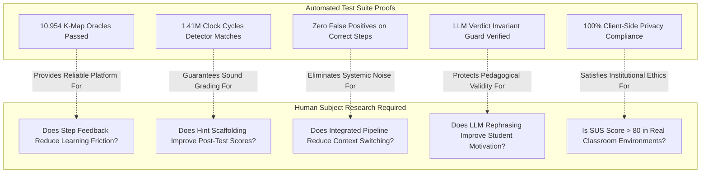

# Research Gap Mapping and Evidence Matrix

This document provides a comprehensive mapping of the system's pedagogical and architectural features to the three primary research gaps established in the project specification. It articulates the exact source files implementing each feature, the corresponding automated tests providing empirical verification, the scientific claims substantiated by these tests, and the honest boundaries between software verification and empirical educational research.

---

## 1. Feature to Research Gap Matrix

| Feature / Subsystem | Primary Gap Addressed | Implementation File(s) | Evidencing Test File(s) | Verified Correctness Property / Metric |
| :--- | :--- | :--- | :--- | :--- |
| **Unified `DesignProject` Model** | **Gap 1: Integration** | `src/types/project.ts`, `src/store/projectStore.ts` | `src/types/project.test.ts`, `src/store/projectStore.test.ts` | Bidirectional cross-module serialization and state restoration without data loss across combinational and sequential pipelines. |
| **Pipeline Stepper & Progress Navigation** | **Gap 1: Integration** | `src/components/PipelineStepper.tsx` | `src/components/PipelineStepper.test.tsx` | Stage completion status tracking, forward navigation gating, and backward review without state destruction. |
| **Combinational Synthesis Pipeline** *(Boolean $\rightarrow$ K-Map $\rightarrow$ Gate Circuit)* | **Gap 1: Integration** | `src/modules/boolean/BooleanPage.tsx`, `src/modules/kmap/KMapPage.tsx`, `src/modules/circuit/CircuitPage.tsx` | `src/modules/boolean/walkthrough.test.tsx`, `src/modules/kmap/walkthroughStage7C.test.tsx`, `e2e/pipeline-boolean-to-circuit.spec.ts` | Automated handoff: canonical SOP expression parses to truth table, transfers minterms to K-map grid, and synthesizes minimal covers into runnable gate netlist. |
| **Sequential Synthesis Pipeline** *(Flip-Flop $\rightarrow$ FSM $\rightarrow$ Excitation $\rightarrow$ Circuit)* | **Gap 1: Integration** | `src/modules/flipflop/FlipFlopPage.tsx`, `src/modules/sequential/SequentialPage.tsx`, `src/modules/kmap/KMapPage.tsx`, `src/modules/circuit/CircuitPage.tsx` | `src/modules/flipflop/walkthroughStage9B.test.tsx`, `src/modules/sequential/SequentialPage.test.tsx`, `e2e/counter-designer-flow.spec.ts` | Multi-step handoff: flip-flop excitation selection generates next-state equations, feeds excitation K-maps, and generates synchronized sequential schematic. |
| **Cross-Module Seed Projects** | **Gap 1: Integration** | `src/engine/practice/seedProjects.ts`, `src/modules/practice/SeedProblemsModal.tsx` | `src/engine/practice/seedProjects.test.ts` | 24 multi-stage reference projects (8 combinational, 8 counter, 8 sequence detector) verify end-to-end pipeline traversals. |
| **Discrete Step Submission Model** | **Gap 2: Step-Level Feedback** | `src/types/feedback.ts`, `src/engine/feedback/engine.ts` | `src/engine/feedback/engine.test.ts` | Immediate step-by-step diagnostic evaluation replacing monolithic end-of-task binary pass/fail grading. |
| **Plug-in Validator Registry** | **Gap 2: Step-Level Feedback** | `src/engine/feedback/validatorRegistry.ts` | `src/engine/feedback/validatorRegistry.test.ts` | Deterministic validator dispatching by module ID, step type, and submission payload with zero false-positive pass rates on correct answers. |
| **21-Tag Misconception Catalog** | **Gap 2: Step-Level Feedback** | `src/engine/feedback/misconceptions.ts` | `src/engine/feedback/misconceptions.test.ts` | Exhaustive cognitive catalog covering algebraic, spatial, sequential, and conversion errors across all 14 active modules. |
| **Three-Tier Progressive Hint Ladder** | **Gap 2: Step-Level Feedback** | `src/engine/feedback/hintLadder.ts`, `src/components/HintLadder.tsx` | `src/engine/feedback/hintLadder.test.ts` | Scaffolding ladder delivering Nudge $\rightarrow$ Pointed $\rightarrow$ Worked Step hints, preserving student agency before disclosing solutions. |
| **Anti-Thrashing Answer-Trap Detection** | **Gap 2: Step-Level Feedback** | `src/engine/feedback/answerTrapDetector.ts`, `src/components/AnswerTrapBanner.tsx` | `src/engine/feedback/answerTrapDetector.test.ts` | Intercepts repeated cyclical errors and rapid trial-and-error guessing (threshold $\ge 3$), triggering conceptual pause warnings. |
| **Student-Mode K-Map Group Checking** | **Gap 2: Step-Level Feedback** | `src/engine/kmap/studentGroupValidator.ts`, `src/modules/kmap/KMapPage.tsx` | `src/engine/kmap/studentGroupValidator.test.ts` | Identifies invalid group dimensions (non-powers of 2), non-rectangular selections, unessential redundant loops, and omitted 1s. |
| **Counter State Table & Lockout Verification** | **Gap 2: Step-Level Feedback** | `src/engine/sequential/counterSynthesis.ts`, `src/engine/sequential/stateTableValidator.ts` | `src/engine/sequential/counterSynthesis.test.ts`, `src/engine/sequential/stateTableValidator.test.ts` | Validates excitation transitions across JK, T, D, SR types; simulates unused states to diagnose self-starting failures and dead-end lockouts. |
| **Sequence Detector Overlap Checking** | **Gap 2: Step-Level Feedback** | `src/engine/sequential/detectorSynthesis.ts`, `src/modules/sequential/SequenceDetectorPage.tsx` | `src/engine/sequential/detectorSynthesis.test.ts` | Detects overlapping vs. non-overlapping transition errors and Mealy vs. Moore output timing discrepancies. |
| **Tagged Quiz Distractor Engine** | **Gap 2: Step-Level Feedback** | `src/engine/feedback/quizBank.ts`, `src/modules/quiz/QuizPage.tsx` | `src/engine/feedback/quizBank.test.ts` | Diagnostic multiple-choice items where every distractor is explicitly tied to a verified misconception tag. |
| **Fine-Grained Telemetry Logging** | **Gap 2: Step-Level Feedback** | `src/store/logStore.ts`, `src/modules/research/TeacherDashboard.tsx` | `src/store/logStore.test.ts`, `src/modules/research/TeacherDashboard.test.tsx` | Granular, in-memory/localStorage logging capturing timestamped step events, active time, hint requests, and misconception tags. |
| **Number System Conversion Diagnostic** | **Gap 2: Step-Level Feedback** | `src/engine/numberSystems/converter.ts`, `src/modules/numberSystems/NumberSystemsPage.tsx` | `src/engine/numberSystems/converter.test.ts` | Step-by-step radix base conversion diagnostics detecting radix confusion, sign extension errors, and binary-coded decimal flaws. |
| **Bounded LLM Pedagogical Rephrase** | **Gap 3: Bounded Generative AI** | `src/engine/feedback/llmAdapter.ts`, `src/components/DiagnosisCard.tsx` | `src/engine/feedback/llmAdapter.test.ts` | Display-only adapter transforming deterministic engine diagnoses into encouraging prose without altering verdict or hint level. |
| **Verdict Immutability Boundary Guard** | **Gap 3: Bounded Generative AI** | `src/engine/feedback/llmAdapter.ts` | `src/engine/feedback/llmAdapter.test.ts` | Structural validator asserting that LLM outputs cannot alter `isCorrect`, cannot suppress misconception tags, and cannot bypass hints. |
| **Client-Side Key & Consent Isolation** | **Gap 3: Bounded Generative AI** | `src/store/studyStore.ts`, `src/store/uiStore.ts` | `src/store/studyStore.test.ts`, `src/store/uiStore.test.ts` | Zero telemetry transmission to external cloud services; LLM API keys remain in client memory/localStorage and are never logged to CSV. |
| **K-Map Brute-Force Oracle Minimizer** | **Deterministic Core Guarantee** | `src/engine/kmap/solver.ts`, `src/engine/common/bruteForceMinimizer.ts` | `src/engine/kmap/solverOracle.test.ts` | Mathematical equivalence proof across all 256 3-variable and all 65,536 4-variable boolean functions with 0 solver disagreements. |
| **Sequential Detector Behavioral Oracle** | **Deterministic Core Guarantee** | `src/engine/sequential/detectorSynthesis.ts` | `src/engine/sequential/detectorSynthesis.test.ts` | 131,008 pseudo-random bit strings across 1,410,208 clock cycles verified against formal regular expression oracle with 0 mismatches. |
| **Discrete-Event Simulator Engine** | **Deterministic Core Guarantee** | `src/engine/circuit/simulator.ts` | `src/engine/circuit/simulator.test.ts` | Priority-queue discrete event simulation verified against half/full adders, latches, flip-flops, and a 500-gate 100-bit adder. |
| **Evaluation Statistics Engine** | **Deterministic Core Guarantee** | `src/engine/evaluation/statistics.ts` | `src/engine/evaluation/statistics.test.ts` | Numerical verification of Hake normalized gain ($g$), Cohen's $d$, Student's paired $t$-test, and Brooke SUS against reference benchmarks. |

---

## 2. Contributions and Evidence Boundaries

A foundational principle of scientific integrity is maintaining an unambiguous distinction between **software verification** (what automated test suites prove) and **pedagogical efficacy** (what empirical human subject research demonstrates).

### Claim 1: Integrated Pipeline Synthesis (Gap 1)
- **What the Software Tests Prove**: The `DesignProject` state container, serialization mechanisms, and pipeline stepper successfully transfer synthesized models across module boundaries without data loss or schema distortion (`src/types/project.test.ts`, `src/store/projectStore.test.ts`, `e2e/pipeline-boolean-to-circuit.spec.ts`).
- **What the Tests Do NOT Prove**: The tests do not prove that working within an integrated pipeline yields statistically higher student learning gains ($g$) than teaching combinational and sequential logic using separate, disconnected tools. That hypothesis requires running the empirical study outlined in [docs/evaluation-protocol.md](evaluation-protocol.md).

### Claim 2: Step-Level Feedback and Misconception Remediation (Gap 2)
- **What the Software Tests Prove**: The diagnostic validator registry deterministically flags 21 specific cognitive error patterns, emits three progressive scaffolding hint levels, and reliably trips the answer-trap banner after repeated failures with 0 false-positive diagnoses on known correct submissions (`src/engine/feedback/validatorRegistry.test.ts`, `src/engine/feedback/answerTrapDetector.test.ts`).
- **What the Tests Do NOT Prove**: The tests do not prove that reading these hints eliminates misconceptions in students' mental models, nor that students do not "game" the hint system by clicking through to worked steps. Validating cognitive remediation requires analyzing telemetry CSV exports from real classroom cohorts.

### Claim 3: Bounded LLM Rephrasing vs. Deterministic Ground Truth (Gap 3)
- **What the Software Tests Prove**: When external generative AI APIs are enabled, the adapter structure strictly forces LLM output to serve as presentation-only prose; the deterministic grading engine maintains absolute control over step correctness, score allocation, and misconception classification (`src/engine/feedback/llmAdapter.test.ts`).
- **What the Tests Do NOT Prove**: The tests do not prove whether students perceive LLM-rephrased hints as more empathetic, understandable, or motivating than raw deterministic rule templates, nor whether LLM phrasing introduces subtle pedagogical distractions. Evaluating the qualitative impact of generative rephrasing requires controlled A/B testing with human learners.

### Claim 4: Algorithmic Correctness and Numerical Fidelity
- **What the Software Tests Prove**: The K-map solver matches independent brute-force minimization across 10,954 functions (`src/engine/kmap/solverOracle.test.ts`), the sequential detector engine matches formal regular expressions over 1,410,208 clock cycles (`src/engine/sequential/detectorSynthesis.test.ts`), and the statistical analysis formulas match standard textbook benchmarks (`src/engine/evaluation/statistics.test.ts`).
- **What the Tests Do NOT Prove**: The tests do not prove that the heuristics scale to arbitrary $N$-variable systems beyond the configured architectural limits ($N \le 6$ variables for truth tables, $N \le 5$ variables for K-maps).

---

## 3. Implemented Modules and Remaining Limits

The ALU, 8086 emulator, and 8259A interrupt controller are implemented and available in the application. The limitations below describe current scope rather than unbuilt modules.

### Known Technical & Algorithmic Limitations
1. **Heuristic Algebraic Simplification**:
   - The Boolean expression simplifier (`src/engine/boolean/simplifier.ts`) applies heuristic rewrite rules (Idempotence, Complement, De Morgan's, Absorption, Consensus). While algebraically sound, it does not guarantee a globally minimal algebraic literal count for all expressions (minimal covers are generated via the Quine-McCluskey K-map engine).
2. **Variable Scalability Bounds**:
   - Truth tables are capped at $N \le 6$ variables ($2^6 = 64$ rows) to preserve instant UI responsiveness.
   - Karnaugh maps are capped at $N \le 5$ variables (two $4 \times 4$ sub-grids) due to spatial visualization constraints.
   - State diagrams are optimized for FSMs with $\le 8$ states ($Q_2 Q_1 Q_0$) to maintain legible graph layout.
3. **Discrete Simulator Netlist Size**:
   - Gate-level circuit simulation uses an event-driven queue tested up to 500 gates (100-bit ripple carry adder). Netlists exceeding 1,000 gates may experience frame drops on lower-spec mobile devices.
4. **Third-Party LLM Dependency**:
   - Generative rephrasing relies on the Anthropic Messages API. In offline environments or under network partitions, the system gracefully falls back to deterministic rule templates.
